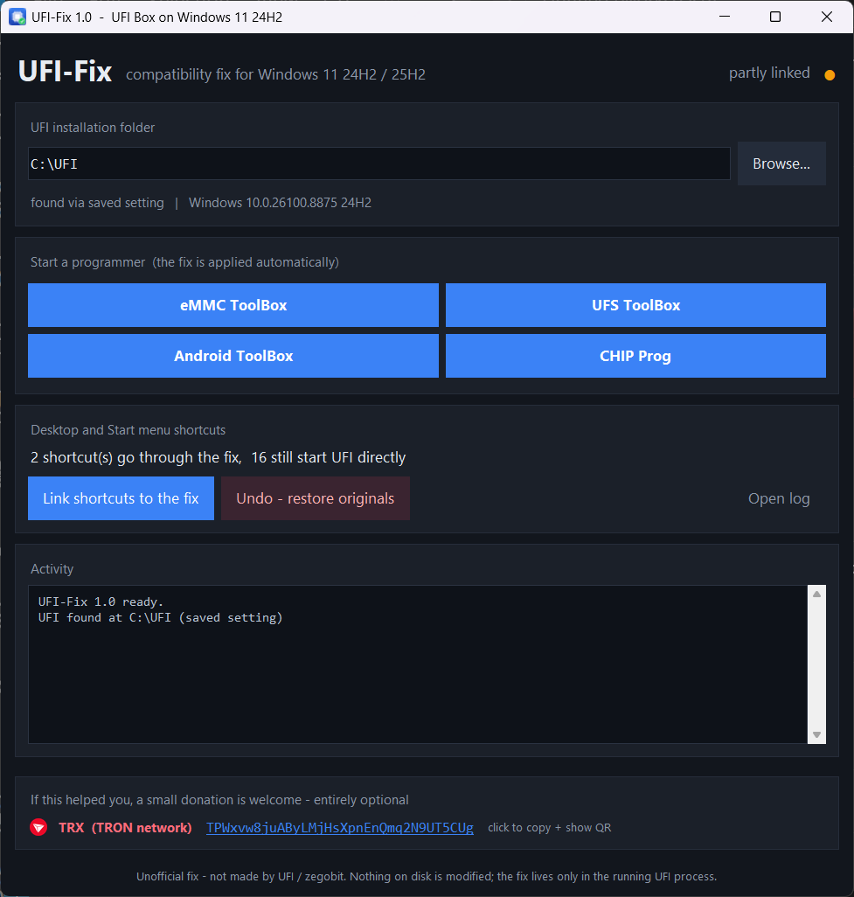

# UFI-Fix

**Run the UFI Box software on Windows 11 24H2 / 25H2.**

Unofficial community fix. Not made by, affiliated with, or endorsed by UFI / zegobit.

If your UFI software dies on startup with this error, this tool is for you:

```
Access violation at address 01D31877 in module 'UFI.exe'.
Read of address 1D54378B.
```

It has nothing to do with your box, your dongle, your drivers or your licence. It is a
compatibility problem between the UFI software and newer Windows builds, and it affects
every UFI installation on Windows 11 24H2 and 25H2. UFI support has acknowledged it since
February 2025; their only advice is to downgrade Windows.

---

## What actually goes wrong

When UFI starts, `UFI.exe` is a small 32-bit Delphi loader that unpacks the real 43 MB
application and runs it in a second process (process hollowing). That application's copy
protection rewrites the import table: **428 of the 965 Windows API entries** are routed
through stubs of its own. Before jumping into the real API, each stub parses the first
bytes of the function with a small built-in instruction decoder.

In Windows 11 24H2 Microsoft recompiled parts of the system DLLs, and the prologue of
several APIs now contains an SSE instruction:

```asm
0F 57 C0        xorps  xmm0, xmm0
0F 11 45 CC     movups [ebp-0x34], xmm0      ; <-- 4 bytes
```

The protection's decoder counts `0F 11 ..` as **2 bytes**. It lands in the middle of the
next instruction, reads a meaningless pointer, and the program dies. The first API UFI
hits is `user32!GetClientRect`.

The proof is in the crash context: `ecx` points at `GetClientRect+0x50`, which is exactly
two bytes into that four-byte instruction.

About 30 exported functions across the DLLs UFI loads contain the same pattern in their
first `0x50` bytes.

## What the tool does

It starts UFI, finds the protected child process the loader creates, and — **inside that
process only** — moves the offending instruction out of the range the stub parses. The
original instructions are copied to a trampoline and replaced with a jump, so the Windows
function still behaves exactly as before. Roughly 38 functions are treated per run, and
the tool keeps watching so DLLs loaded later are covered too.

- No file on disk is modified
- No Windows file is touched
- Nothing outside the running UFI process is changed
- **UFI's protection and licence checks are left completely alone** — you still need your
  genuine box/dongle, exactly as before

The fix exists only in memory and disappears when UFI closes.

## Install

Download `UFI-Fix-Setup.exe` from [Releases](../../releases), run it, press **Install**.
It asks for administrator rights, installs to `C:\Program Files\UFI-Fix`, creates a
desktop shortcut and points your existing UFI icons at the fix (keeping a backup of each).

Then just start UFI the way you always did. All four programmers work:

| | |
|---|---|
| UFI - eMMC ToolBox | UFI - UFS ToolBox |
| UFI - Android ToolBox | UFI - CHIP Prog |



## Usage

| Command | What it does |
|---|---|
| `UFI-Fix.exe` | open the window |
| `UFI-Fix.exe /emmc` | start the eMMC ToolBox with the fix |
| `UFI-Fix.exe /ufs` | start the UFS ToolBox |
| `UFI-Fix.exe /android` | start the Android ToolBox |
| `UFI-Fix.exe /chip` | start the CHIP Programmer |
| `UFI-Fix.exe --link` | point the UFI shortcuts at the fix |
| `UFI-Fix.exe --restore` | put the shortcuts back |
| `UFI-Fix.exe --uninstall` | remove the tool completely |

### If UFI is installed somewhere else

The tool finds it by itself, in this order:

1. the setting you chose before
2. the registry: `HKCU\SOFTWARE\ZEGOBIT\UFI\Install` → `Directory`
3. a running UFI process
4. the existing UFI shortcuts
5. the usual places: `C:\UFI`, `D:\UFI`, … and Program Files

Otherwise use **Browse** and point it at the folder that contains `UFI.exe`; your choice
is remembered. Tested with UFI installed on a second drive.

## Everything is reversible

1. The actual fix lives only in the memory of the running UFI process. Close UFI and it is
   gone. Nothing is left behind on disk.
2. The only permanent change is the shortcuts, and every one is backed up next to itself as
   `<name>.lnk.orig` before it is touched. **Undo – restore originals** (or `--restore`)
   puts them all back.
3. Full removal: *Apps & features → UFI-Fix → Uninstall*, or `UFI-Fix.exe --uninstall`.
   That restores the shortcuts and deletes the program folder, the settings in
   `%LOCALAPPDATA%\UFI-Fix` and the registry entry.

## Notes

- After a UFI update its installer recreates its own shortcuts, so open UFI-Fix once and
  press **Link shortcuts to the fix** again.
- If you start `UFI.exe` directly — not through a shortcut and not from the UFI-Fix
  window — the fix is not applied and the old crash comes back.
- Windows updates are fine. The tool locates the affected functions live every time it
  runs; no fixed addresses are stored anywhere.
- Log file: `%LOCALAPPDATA%\UFI-Fix\UFI-Fix.log`

## Build from source

Requires Python 3.11+ on Windows.

```bat
pip install capstone qrcode pyinstaller pillow

python src/make_icon.py
python src/make_tron.py

pyinstaller --onefile --noconsole --uac-admin --name UFI-Fix ^
    --icon assets/icon.ico --add-data "assets/icon.ico;." --add-data "assets/tron.png;." ^
    --hidden-import qrcode --exclude-module PIL --exclude-module numpy --exclude-module cv2 ^
    src/UFI-Fix.py

pyinstaller --onefile --noconsole --uac-admin --name UFI-Fix-Setup ^
    --icon assets/icon.ico --add-data "assets/icon.ico;." --add-data "README.txt;." ^
    --add-data "dist/UFI-Fix.exe;." --exclude-module PIL --exclude-module numpy ^
    src/UFI-Fix-Setup.py
```

`Pillow` is only needed to redraw the icons; exclude it from the executables or the build
grows from 14 MB to 34 MB.

## Support

The tool is free and always will be. If it saved you from reinstalling Windows and you
would like to say thanks:

| | |
|---|---|
|  | **TRX (TRON network)** — `TPWxvw8juAByLMjHsXpnEnQmq2N9UT5CUg` |

Clicking the address inside the tool copies it and shows a QR code. Any amount is welcome,
and nothing in the tool changes whether you donate or not. TRON (TRC20) network only.


## Disclaimer

This software is provided as is, without warranty of any kind. It works around an
instruction-decoding bug so that people who own a genuine UFI Box can keep using the
software they paid for on a current version of Windows. It does not defeat, remove or
weaken any licence check, and it does not make UFI usable without the hardware.

UFI, UFI Box and zegobit are trademarks of their respective owners.

## License

[MIT](LICENSE)
